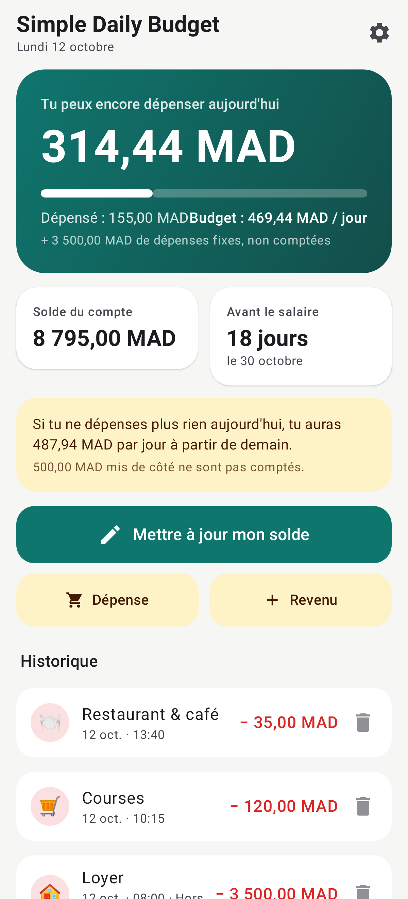
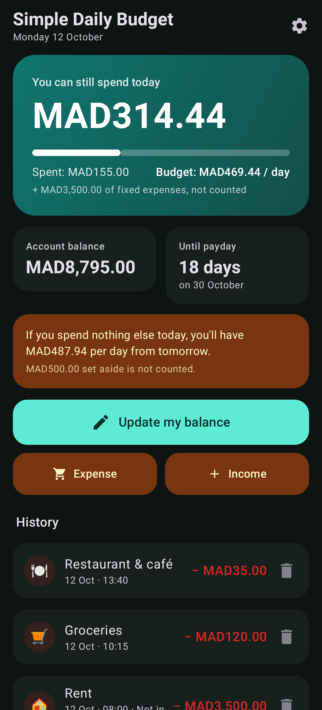
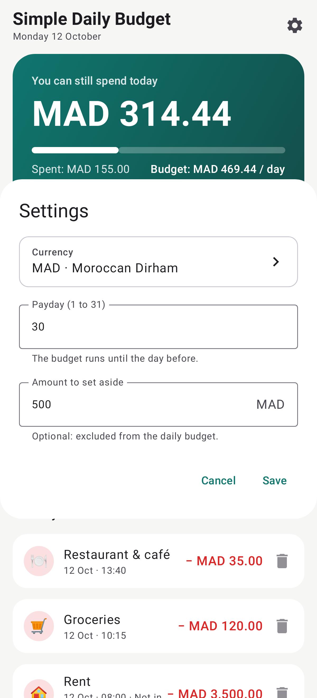

# Simple Daily Budget

A simple Android app that tells you **how much you can spend per day** until your next payday.
Available in English and French (follows the phone language, or pick it per app in Android 13+ settings).

### 📲 [Download the latest APK](https://github.com/X3SED/dailybudget/releases/latest)

All versions: [Releases](https://github.com/X3SED/dailybudget/releases)

| Home (FR) | Dark mode (EN) | Settings |
|:---:|:---:|:---:|
|  |  |  |

## How it works

1. In ⚙️ **Settings**, pick your **currency** (MAD, EUR, USD… any ISO currency), your **payday** (e.g. 1 or 28)
   and optionally an **amount to set aside**.
2. Tap **Update my balance** and type what's left in your account. That's it.
3. The app shows:
   - what you can **still spend today**;
   - your **daily budget** = (balance − set-aside) ÷ days left until payday (today included);
   - how much you'll have per day **from tomorrow** if you spend nothing else today.

The daily budget is fixed from the balance at the start of the day, so it doesn't drop as you spend:
just updating the balance is enough, the app works out what you spent today.

Optionally you can log an **expense** (with a category: groceries, car & fuel, shopping, rent…) or an **income** (salary…).

### Fixed / exceptional expenses

Rent, bills or a family transfer at the start of the month shouldn't show as "over budget today".
Mark them as **fixed / exceptional** (on by default for car & fuel, rent, bills and family): they lower the balance — so the
daily budget for the rest of the month — but don't count against today's spending. When you only update your balance,
tick **"This drop comes from fixed expenses"** for the same effect.

All data stays on the phone.

## Download the APK

Every push runs the **Build APK** GitHub Actions workflow, which publishes the APK under
[**Releases**](https://github.com/X3SED/dailybudget/releases/latest).
Download the `.apk` on your phone, open it and allow installs from that source if Android asks.

APKs are signed with `app/dailybudget.keystore` from the repo so each version installs over the previous one
without losing data.

## Screenshots

The images above are rendered from demo data by `ScreenshotTest` (Robolectric + Roborazzi) and committed
to `docs/screenshots` by the CI on every push.

## Build it yourself

With the Android SDK (JDK 17+): `./gradlew assembleRelease` → `app/build/outputs/apk/release/`.
